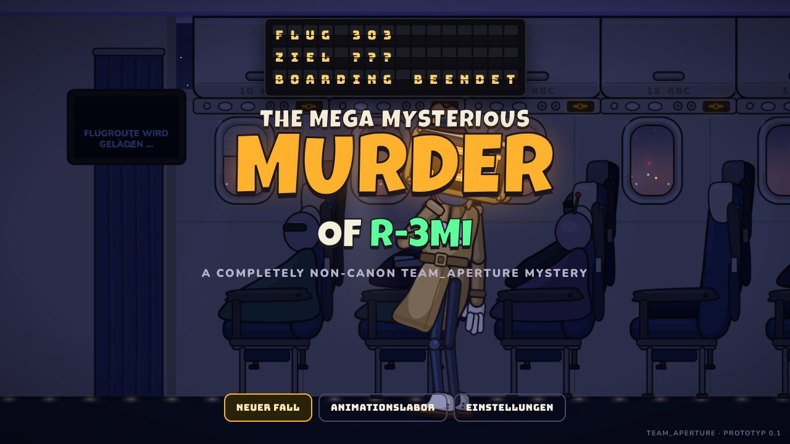
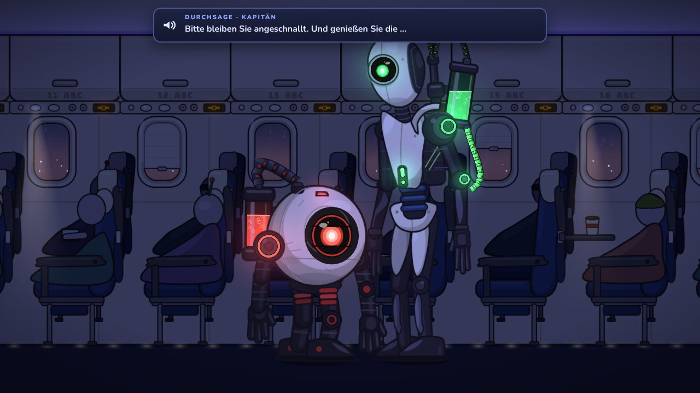
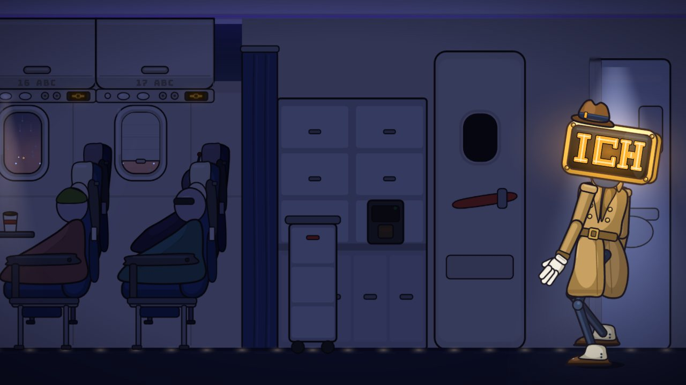
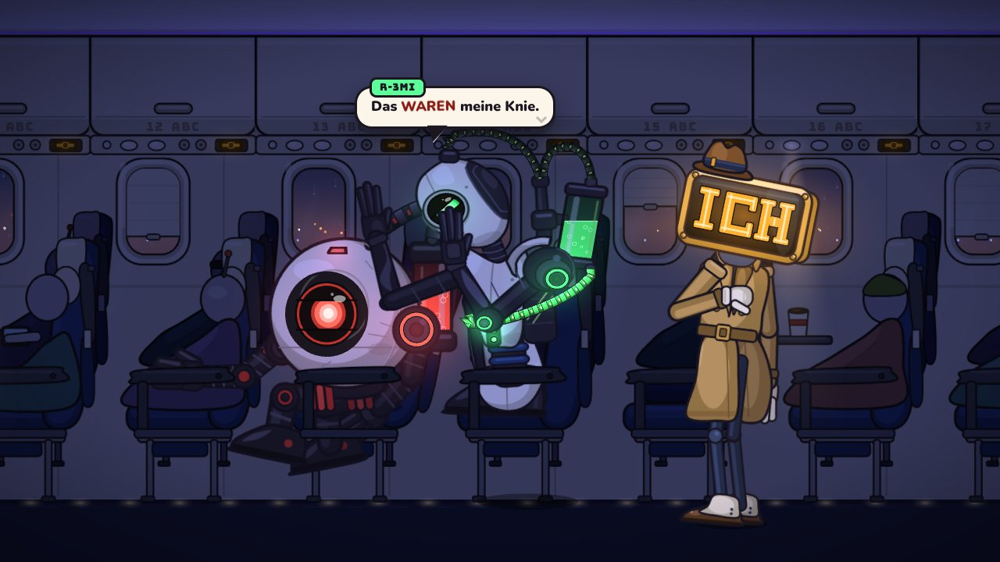
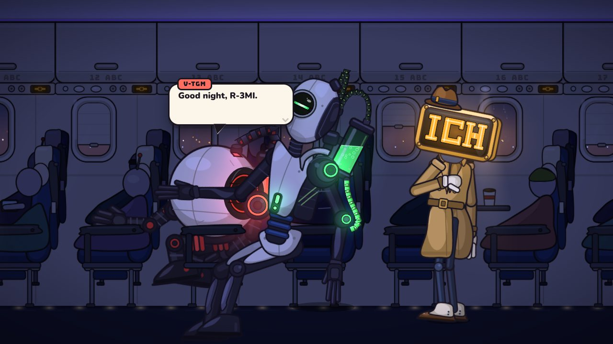
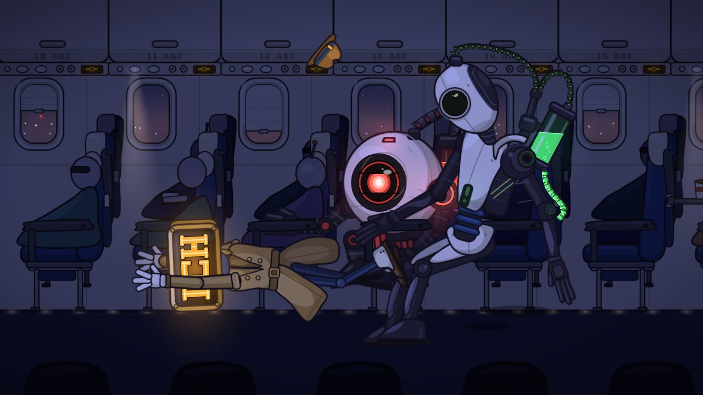
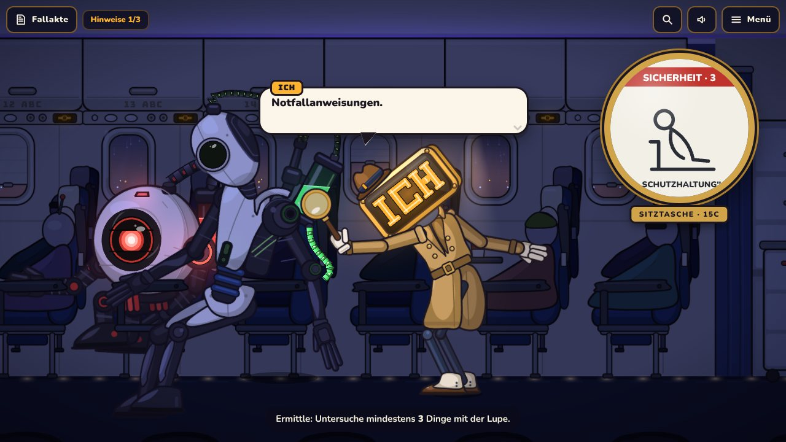
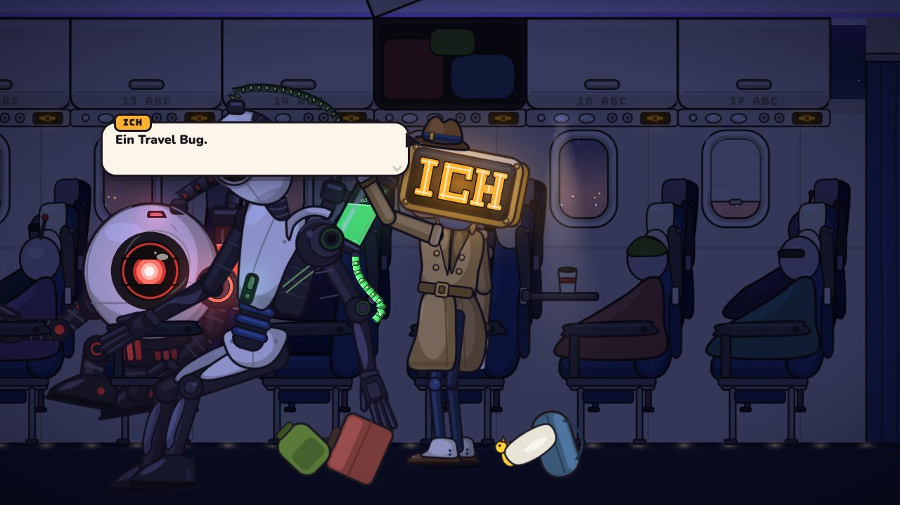
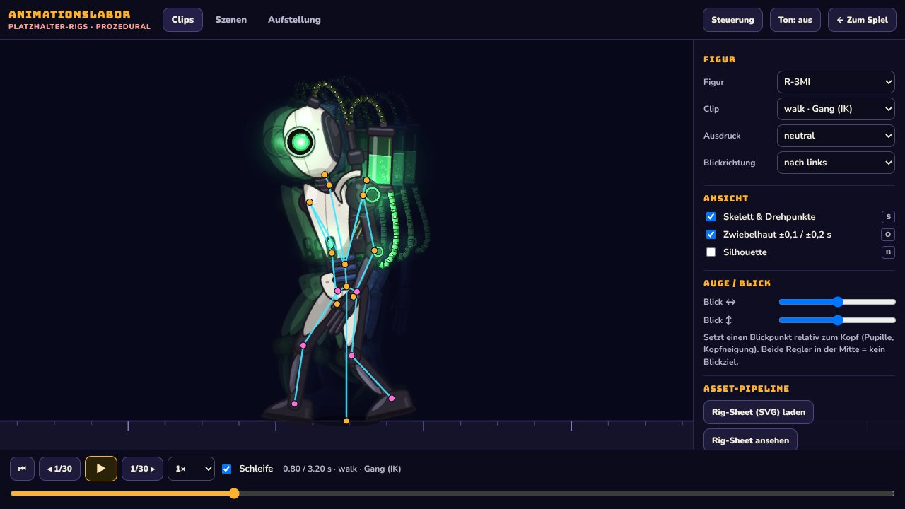
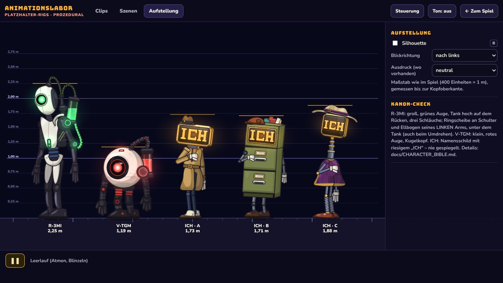

# THE MEGA MYSTERIOUS MURDER OF R-3MI

*A Completely Non-Canon Team_Aperture Mystery*

A humorous, animated 2D detective adventure aboard Flight 303, with German dialogue.
R-3MI hates flying and falls into a very deep sleep. A brand-new detective robot named **ICH**
is convinced that this is a case. V-TGM has seen enough.

This repository contains **Chapter 0** as a vertical slice: title sequence, opening, ICH's
entrance, the meeting, R-3MI's fight with his seat, an investigation, a slapstick trip and the
teaser ending. It also contains an **Animation Lab** for inspecting and replaying every animation.
It is a separate project from Kalibrierungsanlage III and shares no code with it.

> **Status:** prototype. The systems are real; the character art and motion are procedural
> placeholders, not final hand-drawn quality. See [docs/STATUS.md](docs/STATUS.md).

| | |
| --- | --- |
|  |  |
| Title: the departure board never says "departed" | Opening: Flight 303 at night |
|  |  |
| ICH's entrance from the lavatory | R-3MI against seat 14C |
|  |  |
| "Good night, R-3MI." | ICH meets R-3MI's legs in the aisle |
|  |  |
| Investigating with the magnifier | The overhead bin: a find |
|  |  |
| Animation Lab: skeleton, pivots and onion skin on the walk | Lineup with the three ICH design directions |

*Screenshots are re-simulated game frames (software-rendered), placeholder art.*

## Run it

```bash
npm install
npm run dev          # http://localhost:5173
npm run build        # static site in dist/ (no server code, no paid services)
npm run preview      # serve the build on :4173
```

Requirements: Node 20+ and a browser with WebGL. Tested so far in Chromium (desktop and emulated phones,
including touch); Firefox, Safari and real phones are still to be tested. Landscape is recommended on phones.

## Play

| | Desktop | Touch |
| --- | --- | --- |
| Walk | click the floor, or <kbd>A</kbd>/<kbd>D</kbd> / arrow keys | tap the floor |
| Examine | click a thing, or <kbd>E</kbd> near it; <kbd>Tab</kbd> shows everything examinable | tap a magnifier marker |
| Dialogue | click, <kbd>Space</kbd> or <kbd>Enter</kbd>; choices with <kbd>1</kbd>–<kbd>3</kbd> | tap |
| Case file / sound / menu | <kbd>F</kbd> / <kbd>M</kbd> / <kbd>Esc</kbd> | buttons at the top |

*Einstellungen* has volumes, text speed, V-TGM's language (canon: English with German subtitles),
reduced motion and the ICH design direction (A, B or C).

## Animation Lab

Open it from the title menu (*Animationslabor*) or at `/?lab`.

- **Clips:** any character and clip, including the IK walk. Play, pause, scrub, 0.1×–2× speed and single
  frame steps. Overlays for the skeleton and pivots, onion skin and silhouette. Expressions and eye
  direction. You can also download the rig sheet as SVG for an artist.
- **Szenen:** every cutscene of Chapter 0 on a timeline with clickable event markers. Rewinding
  re-simulates from zero, so each frame is exactly what the game shows.
- **Aufstellung:** all characters, including the three ICH directions, side by side with a height chart.

The state lives in the URL, so a view can be shared, e.g. `/?lab&mode=clips&c=r3mi&clip=clap&t=0.6&skel=1`.

## Development

```bash
npm run check        # typecheck + unit tests + build
npm run test:e2e     # Playwright: boot, full chapter (desktop + phone), Lab, determinism, ICH designs
ICH_DESIGN=b npx playwright test chapter --project=desktop   # the whole chapter as ICH design B (or c)
node scripts/shot.mjs "?dev=pose&c=r3mi&clip=walk&n=6&step=0.15&face=-1" out.png 1400 600
node scripts/play.mjs out-dir [width] [height] [touch]   # scripted playthrough with screenshots
```

Developer routes: `?dev=sheet&c=<id>` (raw rig sheet), `?dev=pose&c=<id>&clip=<clip>&t=<s>&face=-1`
(one deterministic frame, or `n`/`step` for a filmstrip), `?dev=cabin`, `?dev=seq&id=<scene>&t=<s>`
(one cutscene frame, re-simulated from zero).

| Folder | Contents |
| --- | --- |
| `src/anim` | Skeleton, clips, animator, IK, gait, rope, atlas |
| `src/characters` | R-3MI, V-TGM, ICH (directions A/B/C): geometry, rig sheets, rigs, clips, live features |
| `src/world` | Cabin, layout, camera |
| `src/story` | Chapter flow, cutscenes (deterministic sequences), clues, title |
| `src/game`, `src/ui`, `src/audio` | Game loop and input, DOM UI, synthesised audio |
| `src/lab` | The Animation Lab |
| `docs` | Creative direction, character bible, ICH design directions, animation pipeline and risks, status, reference guide; `SPOILERS_TEAM_ONLY.md` is for the team only |

## Credits

Team_Aperture. Characters R-3MI and V-TGM © Team_Aperture (from *Kalibrierungsanlage II*); ICH is
new for this game. Fonts: Bungee, Nunito, Special Elite and Luckiest Guy (SIL Open Font License, via
@fontsource).
