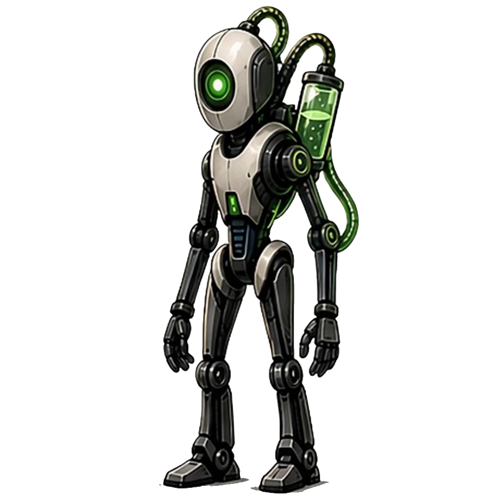
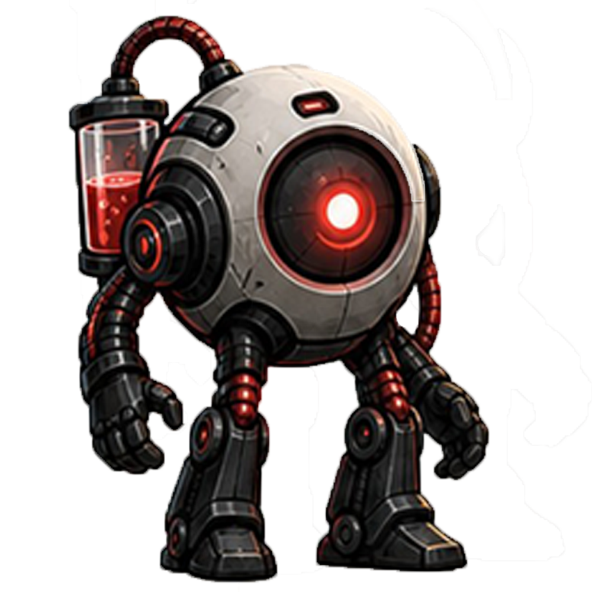
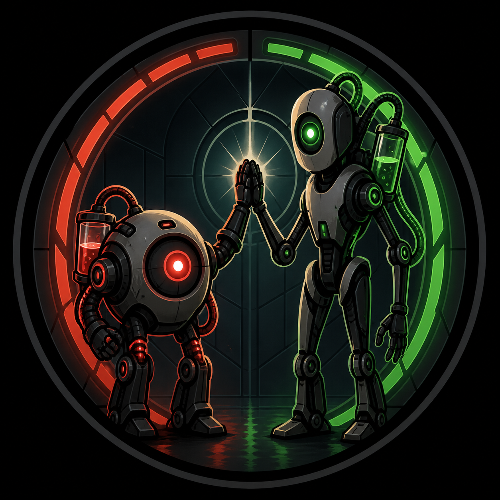

# Reference guide: what was inspected, and what it tells us

All sources below were cloned **read-only** (shallow, anonymous) and nothing in them was modified.
This file lists exactly what was looked at, so nobody has to guess which canon the spin-off rests on.

| Repository | Commit inspected | What it contributed |
| --- | --- | --- |
| `Team-Aperture/anlage-ii` (KA-II, *Die Reaktivierung*) | `d21fe41` | **The two portraits** (`assets/portraits/r3mi_neutral.png`, `vtgm_neutral.png`), first-contact dialogue in `chapter1/chapter1.js`, guest characters |
| `Team-Aperture/liebeaufdenerstenlog` | `6e6cd05` | Canon rules for language and colour (`README.md`, `js/hosts.js` palette and expression list) |
| `Team-Aperture/pausenprotokoll` | `ae4c361` | More banter, the rule that the two only use designations, R-3MI's fidgeting and V-TGM's calm |
| `Team-Aperture/rundheitsprotokoll` | `857f73d` | `team-aperture-symbol.png`, the high-five emblem in painted form |
| `Team-Aperture/kalibrierungsanlage-iii` | `3def39e` | Pixel-art re-draw of the emblem (a derivative, **not** used as a reference) |
| `Team-Aperture/kalibrierungsanlage`, `dunkelprotokoll` | latest | Checked; no additional character art (dunkelprotokoll has a *corrupted* V-TGM, a horror variant we deliberately ignore) |

Copies of the three images live in [`reference/`](reference/) for convenience. They are Team_Aperture's
own artwork and are used here only as model-sheet references.

## The primary visual references

| R-3MI | V-TGM | Emblem |
| --- | --- | --- |
|  |  |  |

### Are these images usable as rig assets?

**No, and they should not be cut up.** Reasons, checked on the files themselves:

- They are single flattened paintings (1000 × 1000 px). There are no separated layers, so every limb
  that is hidden behind another (V-TGM's far arm, R-3MI's far leg and hoses) simply does not exist in the image.
- Both are painted in a fixed three-quarter view with baked lighting. Rotating a cut-out forearm would rotate
  its highlight with it, which reads as "paper doll" immediately.
- `vtgm_neutral.png` has an incompletely removed background: large jagged white matte fragments on the right side.
- The painterly rendering (soft airbrush highlights, texture noise) does not match a clean cartoon line style,
  and would look out of place next to newly drawn props.

They are therefore used the way a studio uses a client's character art: as the **model reference**
that the new rig art must match in silhouette, proportion, colour and key features. The rig art in this
project is redrawn as layered vector parts (see [ANIMATION_PIPELINE.md](ANIMATION_PIPELINE.md)).

## Extracted canon (visual)

**R-3MI**: tall, slender, slightly forward-leaning humanoid.
- Head: smooth egg/capsule helmet in bone white, vertical centre seam, dark graphite side panel.
  **One** large round green eye (glowing ring, bright core) on the front face.
- Neck: thin, dark.
- Torso: bone-white chest shield that narrows toward a dark, ribbed waist (navy ribs), small vertical green
  slot light low on the chest.
- Big dark shoulder discs, the near one with a green ring light; green-ringed elbow joint.
- Graphite segmented arms, long; dark articulated hands with long fingers. Fingertips reach the knees.
- Dark graphite pelvis with bone-white hip caps; light front plates on the thighs; dark knee discs; chunky
  dark boots.
- Backpack: a glass cylinder of **green** bubbling liquid with black end caps, high on his back and leaning
  back. Three hoses: a ribbed hoop from a port on the crown to a junction behind the head, a second hoop from
  there to the tank top, and a bright fluid-filled hose from the tank's bottom that bows out behind his left
  upper arm into the back of his left elbow (see CHARACTER_BIBLE.md for the handedness).

**V-TGM**: short; the body and head are one **sphere**.
- Bone-white/warm grey shell with panel seams and visible wear.
- **One** very large red eye: black bezel socket, red ring light, red iris, white-hot centre.
- Small red slit lamp on top of the sphere.
- Large dark hub discs with a red ring at the sides (the arm mounts).
- Long segmented black arms that hang below the hips; big black hands with thick fingers.
- Short chunky legs, red accordion bellows between sphere and legs, red-ringed knees, heavy dark boots.
- Backpack: a glass cylinder of **red** liquid; a ribbed hose arching over the top of the sphere.

**Palette** (from `liebeaufdenerstenlog/js/hosts.js`, itself sampled from the portraits):

| | shell | shade | limb | limb hi | accent | eye | fluid | edge |
| --- | --- | --- | --- | --- | --- | --- | --- | --- |
| R-3MI | `#e7e3d9` | `#bcb7ac` | `#2a2733` | `#3f3b49` | `#2ecf62` | `#5dff9a` | `#45e07a` | `#1b1620` |
| V-TGM | `#ded9d0` | `#b0aaa0` | `#232028` | `#37333d` | `#c0322c` | `#ff6f61` | `#d8443c` | `#1b1620` |

## Extracted canon (character)

These rules are stated explicitly in the earlier projects and are treated as non-negotiable:

1. **R-3MI always speaks German. V-TGM always speaks English**, with a German subtitle, whatever the
   interface language (*Liebe auf den ersten Log*, README: "The two units follow Kalibrierungsanlage canon").
   V-TGM only switches to German to annoy R-3MI (KA-II: *„Sie hat gerade Deutsch gesprochen. Das macht sie nur,
   wenn sie mich ärgern will."*). **Team decision for this game: V-TGM always speaks English, with a German
   subtitle** (no German lines, no German-only setting).
2. The two address each other **only by designation**: R-3MI and V-TGM. No nicknames (*Pausenprotokoll* even
   validates every spoken line for this; this project keeps the rule by hand, there is no automatic check yet).
3. R-3MI: "delighted about everything", optimistic, chatty, a bit obsessive, proud of small wins,
   restless gaze, fidgets. He breaks things while repairing them and calls it precision
   (*„Ich habe den Fehlerbereich präzisiert."*). Greets with *„Hiii!"*.
4. V-TGM: "has opinions". Terse, precise, deadpan, observant (*"I watch. I keep track of what changes."*).
   Corrects R-3MI's facts (*"It was Thursday."*). Calm gaze. Underneath, warm towards R-3MI
   (*"You are doing great, R-3MI."*). Her irritation is aimed at nonsense, never at him as a person.
5. Pronouns used in canon: R-3MI *he* (*"Ignore him."*), V-TGM *she* (*"the one thing about her that panics"*).
6. Established expression vocabulary for the single optic (`hosts.js`): neutral, happy (arc), curious,
   suspicious (half lid), annoyed (slit), panic (wide + shake), error, proud (star), sad.
   This project keeps that vocabulary for R-3MI so the eyes act the way players already know; V-TGM uses
   most of it (not *proud* or *error*) plus her own: deadpan, exasperated, amused, alarmed, fond.

## Guests (not used in Chapter 0)

KA-II introduces guest units that stand in for geocaching personalities: F-RØ5CHI, L-UX, B-RADF1SH,
T-FLON14, ASP-1024, FAX-N, AGN-H3R. They are likely to be the "geocaching-themed personalities" on
Flight 303. **None of them has visual reference art**, and several appear to stand in for real people.
Chapter 0 therefore does not design or characterise them; the sleeping passengers are anonymous
blanket-shapes. See the open questions in [STATUS.md](STATUS.md).
